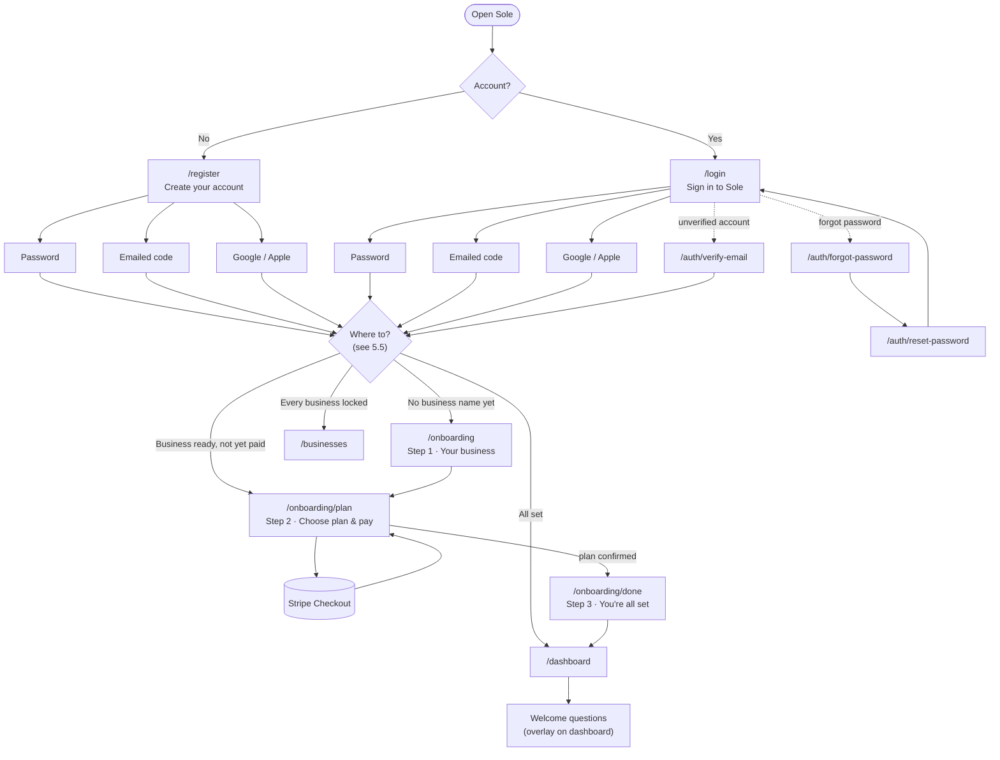

# User Onboarding & Authentication Guide

How a person gets into Sole — creating an account, confirming their email,
signing in, recovering a password, setting up their business, and paying for
their first plan — written for **end users** and **testers**.

- **Users** → read Parts 1–6. Each section says what you will see, what to type, and what to do if something goes wrong.
- **Testers** → Part 7 is a numbered test checklist (scenario → steps → expected result). Part 8 lists every message a person can see. Part 9 lists behaviours that look like bugs or copy problems and need a decision.
- **Developers** → this is the *behaviour* guide. The API/token internals are in [`sole-ocr/docs/AUTHENTICATION.md`](../../sole-ocr/docs/AUTHENTICATION.md) (see Part 10 — that file is out of date for the newer flows).

Verified against the code on **2026-11-03** (`sole-webapp` auth/onboarding screens and `sole-ocr` `modules/auth` + `controllers/subscription.js`). Screens are described from the code, not from screenshots — see the note in Part 10.

## Contents

1. [The journey at a glance](#1-the-journey-at-a-glance)
2. [Before you start](#2-before-you-start)
3. [Creating an account](#3-creating-an-account)
4. [Confirming your email](#4-confirming-your-email)
5. [Signing in, and getting back in](#5-signing-in-and-getting-back-in)
6. [Onboarding: business, plan and payment](#6-onboarding-business-plan-and-payment)
7. [Test scenarios](#7-test-scenarios)
8. [Every message a person can see](#8-every-message-a-person-can-see)
9. [Things to confirm with the team](#9-things-to-confirm-with-the-team)
10. [Source map & related docs](#10-source-map--related-docs)

---

## 1. The journey at a glance

| Stage | Screen | URL |
|---|---|---|
| Create account | Create your account | `/register` |
| Sign in | Sign in to Sole | `/login` |
| Confirm email | Check your email / Verify your email | `/auth/verify-email` |
| Forgot password | Forgot your password? | `/auth/forgot-password` |
| Reset password | Set a new password | `/auth/reset-password?token=…` |
| Social sign-in return | "Signing you in…" | `/auth/social-callback` |
| Accountant sign-in | Accountants and bookkeepers | `/auth/accountant-login` |
| Accountant's invite | Welcome, *Name* | `/accountant-invite` |
| Onboarding 1 | Tell us about your business | `/onboarding` |
| Onboarding 2 | Choose your plan | `/onboarding/plan` |
| Onboarding 3 | You're all set | `/onboarding/done` |
| App | Dashboard | `/dashboard` |
| Business chooser | Businesses | `/businesses` |

The first six rows plus the accountant invite are the **signed-out** screens. Everything under `/onboarding` needs a signed-in session; if yours has ended you are sent to `/login`.

---

## 2. Before you start

**What you need**

- An email address you can open **right now** (codes and links arrive there). Use a real mailbox or a plus-address (`you+test1@yourdomain.com`).
- **Not a throw-away address.** Mailinator, 10minutemail and similar disposable domains are rejected when *creating* an account (existing accounts on such a domain can still sign in). Message: *"Please use a valid, permanent email address."*
- A card. There is **no free trial** — the first plan is paid for during onboarding (see 6.2).

**Test environments only**

- If the environment uses Stripe **test mode**, use Stripe's standard test cards: `4242 4242 4242 4242` (succeeds) or `4000 0000 0000 0002` (declined), any future expiry, any 3-digit CVC, any postcode. Never use a real card on a test-mode environment.
- Disposable-domain blocking can be switched off on non-production backends with `DISPOSABLE_EMAIL_BLOCK_ENABLED=false`. It is **on by default** — if sign-up with a throw-away address is rejected, that is expected.

**Rules that apply everywhere**

| Rule | Value |
|---|---|
| Password | At least **8 characters**, with **a letter** and **a number** (checked as you type) |
| Email code | **6 digits**, valid **10 minutes**, **5** wrong tries then the code is dead |
| Resend a code | Wait **30 seconds** between sends; max **5 codes per email per 15 minutes** |
| Email verification link | Works **once**, expires after **30 minutes** |
| Password reset link | Works **once**, expires after **30 minutes** |
| Stay signed in | Access session lasts **7 days**, renewed automatically for up to **30 days** (environment defaults — `WEB_TOKEN_EXPIRED_TIME`, `REFRESH_TOKEN_TTL_DAYS`) |
| Too many attempts (per IP, per 15 min) | 30 sign-in / sign-up / reset / verification calls · 10 code requests · 30 code checks (defaults; set by environment) |

---

## 3. Creating an account

### 3.1 The sign-up screen (`/register`)

**Heading:** *Create your account* · **Sub-text:** *Set a password to get started, or we'll email you a code instead.*
On a wide screen the left half is a brand panel (*"Your books, sorted from day one."*); on a phone only the form shows.

| Element | What it does |
|---|---|
| **Email** | Required. Must look like `name@domain.tld`. Pre-filled if you came from the sign-in screen. |
| **Create a password** | Placeholder *At least 8 characters*. Shows a strength bar (Too short · Weak · Fair · Good · Strong) and a checklist: *At least 8 characters*, *A letter*, *A number*. The checklist is what is enforced; strength is advice only. The eye icon shows/hides the password. |
| **Confirm password** | Placeholder *Type it again*. Must match. |
| **Accountant or bookkeeper's email** | Only appears when the link has `?id=accountant`. Optional; the accountant is invited to your books once you're set up. |
| **Have a referral or coupon code?** | A text link that reveals **Referral or coupon code** (shown upper-case). If the link already carried a `?refer-code=`, it instead says *Referral code XYZ applied.* |
| **Create account** | Creates the account with the password. Shows *Creating your account…* while working. |
| **Email me a code instead** | Creates the account **without a password**; see 3.3. |
| **Google / Apple** | Sign up with that provider; see 3.4. |
| **Already have an account? Sign in** | Goes to `/login` and keeps the email you typed. |

Errors appear under a field only **after you have typed in it or pressed a button** — an untouched form never shows red text.

Links that pre-fill the form (used by marketing, partners and accountants):

| URL parameter | Effect |
|---|---|
| `?email=` | Pre-fills the email |
| `?code=` | Pre-fills and reveals the coupon field |
| `?refer-code=` | Shows *Referral code … applied* |
| `?id=accountant&accountant_email=` | Shows the accountant field, pre-filled |
| `?spm_accountant_id=…&email=…` | An accountant's client invite — see 3.5 |

### 3.2 Path A — email + password (the main path)

1. Open `/register`, enter email, a password that meets the checklist, and the same password again.
2. Select **Create account**.
3. The account is created and you are **signed in straight away**. A verification email is sent in the background (see Part 4).
4. A new account has no business name yet, so you land on **Onboarding step 1** (`/onboarding`).

What can happen instead:

| You see | Why | What to do |
|---|---|---|
| *This email address is already in use.* + **Sign in instead** | Email already has a password account | Select **Sign in instead** (email is carried over) |
| *This account exists with a Google login, please sign in with Google* + **Sign in instead** | The email was first used with Google/Apple (also shown for LinkedIn/Facebook accounts) | Use that provider on `/login` |
| *Your account is inactive, verify your account now…* and you are moved to **Check your email** | The email signed up before but never confirmed | A fresh verification link was just sent — see Part 4 |
| *Please use a valid, permanent email address.* | Disposable email domain | Use a permanent address |
| *Your password doesn't meet the requirements below yet.* | Fewer than 8 characters, or no letter, or no number | Follow the checklist |
| *Both passwords must match.* | Confirmation differs | Retype it |
| *We couldn't set this browser up for sign-in. Refresh the page and try again.* | The browser could not register itself | Refresh; check cookies are allowed |
| *Too many authentication attempts. Please try again in 15 minutes.* | Rate limit | Wait |

### 3.3 Path B — email me a code (no password)

1. On `/register` enter only an **email** (password fields can stay empty) and select **Email me a code instead**.
2. The screen changes to **Enter your code** with six boxes: *We sent a code to you@…*.
3. Type or **paste** the 6 digits. It submits itself on the sixth digit; **Verify and continue** also works.
4. The account is **created at this moment** (not when the code was sent), the email is marked verified, you are signed in, and you land on Onboarding step 1.

Good to know:

- The account does not exist until the code is entered. Mistyping an email and never confirming leaves **nothing** behind.
- **Resend code** is greyed out as *Resend code in 30s*. **Change email** goes back to the form.
- If a code was sent a moment ago, asking again shows *We already sent you a code — check your inbox.* and carries on with the countdown — you do not lose the code you already have.
- If the email **already has an account**, the code is a **sign-in** code: entering it signs that person in. This is why the sign-up screen never says "already registered" on this path.
- An account created this way has **no password**. Add one later in Settings; until then use a code to sign in (see 5.2).
- Wrong digits → *That code is incorrect or has expired. Please request a new one.* and the boxes clear. After **5** wrong tries → *Too many incorrect attempts. Please request a new code.*

### 3.4 Path C — Google or Apple

1. Select **Google** or **Apple** (on the sign-up screen the buttons read *Sign up Google* / *Sign up Apple*). The button changes to *Redirecting…* and the whole page goes to the provider.
2. Approve on the provider's page.
3. You return to `/auth/social-callback` (*Signing you in…*) and are signed in. A **new** account is created automatically if the email is new; the email counts as already verified, and there is **no password**.
4. New accounts continue to Onboarding step 1; existing accounts go where 5.5 says.

If it fails you are returned to `/login` with one of the messages in Part 8 (cancelled, unavailable, failed, disposable email, or "signed in but couldn't load your profile"). If the **same email** already exists as a password account, the provider sign-in signs into that account (it does not create a second one).

### 3.5 Path D — invited by an accountant

An accountant creates a client in Sole and the client receives an email link to `/accountant-invite?…`.

1. The screen says **Welcome, *First name*** (or *You're invited to Sole*): *Your accountant set this up for you. Choose a password and your account will be ready straight away.*
2. Fields: **Email** (pre-filled, editable), **Switching from** (required — *First time user, Spreadsheets, Xero, QuickBooks, Rounded, Okke, Hnry, Myob*), **Create a password**, **Confirm password**, and an optional coupon (hidden if the invite already carried one).
3. **Create account.** A trusted invite activates the account immediately and you go to onboarding; anything else shows *Check your email* (Part 4).
4. Business name, ABN, phone and industry the accountant already entered are **pre-filled** in onboarding step 1 (still editable).

A link with no usable invite is sent to the normal `/register`. If the email already has an account you see *An account with this email already exists.* + **Sign in instead** — an invite only ever applies to a brand-new account. The invite is remembered in the browser, so it survives a refresh or a detour through email verification.

---

## 4. Confirming your email

Password sign-ups are asked to confirm their address. Code and Google/Apple sign-ups are **already confirmed** and never see this.

### 4.1 What "unverified" means in practice

- Right after a **password sign-up** you are signed in and can start onboarding. A banner across the top of the app reads **"Please verify your email address to keep full access to your account."** with a **Verify email** button.
- If you **sign out and try to sign in again before confirming**, sign-in refuses (*Your account is inactive, verify your account now…*), sends a new link, and moves you to the **Check your email** screen.

### 4.2 The "Check your email" screen (`/auth/verify-email`)

> **Check your email** — *We've emailed you a link to verify your account. Open it to confirm this is you — it expires in 30 minutes.* · *Sent to you@… Can't see it? Check your spam folder.*

| Button | What it does |
|---|---|
| **Resend link** | Sends a new link. Disabled as *Resend link in 30s* after each send. Toast: *Verification link sent*. |
| **Use a code instead** | Emails a 6-digit code (never sent unless you ask). Toast *Code sent* / *A new code is on its way*. |
| *Wrong address? **Change it*** | Back to `/login` |

After choosing a code the screen becomes **Verify your email** — six boxes, **Verify email**, **Resend code**, and **Use the email link instead**. A correct code verifies **and signs you in**.

Opening the screen from the in-app banner sends a fresh link automatically (`?send=1`) — and only once, even if you refresh.

### 4.3 Using the link in the email

The email is titled **Verify your Sole account**. The link opens `/auth/verify-email?token=…&email=…` and shows *Verifying your email…*, then **Thanks for verifying your email** with a **Continue** button.

- **It works in any browser.** Open the link on your phone and it verifies and signs you in *there*; the original browser is unaffected.
- *New account:* "…One quick screen for your business details and GST, then you're in." → Continue goes to onboarding. *Existing account:* "Pick up right where you left off." → Continue goes to the dashboard.
- **A link that is expired (30 min), already used, or incomplete** shows **That link didn't work** — *Verification links work once and expire after 30 minutes. Sign in to carry on — if your address still needs confirming, we'll send you a fresh link.* → **Back to sign in**.
- If the address was already verified another way, signing in simply works.

---

## 5. Signing in, and getting back in

### 5.1 The sign-in screen (`/login`)

**Heading:** *Sign in to Sole* · *Welcome back. Sign in with your password or a code.*

| Element | Notes |
|---|---|
| Email, Password | Password has a show/hide eye. Sign-in does **not** apply the 8-char/letter/number rules, so old accounts are never locked out. |
| **Forgot password?** | Opens `/auth/forgot-password` with your email carried over |
| **Sign in** | *Signing in…* while working |
| **Email me a sign-in code instead** | Code path, see 5.2 |
| **Google / Apple** | Same as 3.4 |
| **Don't have an account? Create one** | To `/register`, email carried over |
| **Are you an accountant or bookkeeper?** → **Accountant Sign up** | Goes to the accountant sign-in (5.4) — see Part 9, this label is misleading |

If you were sent here because something ended, a message sits above the form: *Your session expired. Please sign in again.* · *You've been signed out.* · *Your account has been deleted.* (full list in Part 8).

If you are **already signed in** and open `/login` or `/register`, you are sent straight on (a brief logo splash shows instead of the form).

### 5.2 Signing in with a code

1. Enter your email → **Email me a sign-in code instead**.
2. Enter the 6 digits (**Verify and sign in**). **Use your password instead** goes back.
3. You are signed in and routed by 5.5.

Special cases:

- **Account has no password** (it was created with a code or Google/Apple): entering a password shows *This account signs in with an emailed code. Enter your email address and we will send you one.* with an **Email me a code** button. (For a Google/Apple account the message is *Failed to login because your account associated with Google login.* — use that provider.)
- **Email not registered:** the code screen still opens and says *We sent a code*, but **nothing is sent**. This is deliberate — the app never reveals whether an email is registered. Use **Create one** instead.
- Cool-down, resend, wrong-code and 5-try rules are the same as 3.3.

### 5.3 Forgot and reset password

1. `/auth/forgot-password` — *Forgot your password? Enter the email you signed up with and we'll send you a link to set a new password.* → **Send reset link**.
2. The screen switches to **Check your inbox** — *If an account exists for you@…, the link is on its way.* This is the **same answer for every email**, registered or not (no account lookup). **Resend link** has a 30-second timer; **Change email** goes back.
3. Open the link (`/auth/reset-password?token=…`). It is **checked before the form shows** (*Checking your link…*).
4. **Set a new password** — *New password* (with strength meter + checklist) and *Confirm new password* (shows *Both passwords match.*) → **Save new password**.
5. **Password changed successfully** → **Back to sign in**.

Edge cases: a dead link (expired after 30 minutes, already used, or missing its token) shows **That link has expired** with **Send me a new link** and **Back to sign in**. Reset only works for **password** accounts — for Google/Apple accounts the screen still says "check your inbox" but **no email is sent**. For an **unverified** account the reset is refused with *Your account is not activated. We've resent you an activation email.*

### 5.4 Accountants and bookkeepers (`/auth/accountant-login`)

*Accountants and bookkeepers — Sign in with the credentials for your practice — one login across every client you manage.* Fields: **Work email**, **Password**, **Forgot password?**, **Sign in**, **Back to business sign in**. It uses the **same credentials service** as normal sign-in; the account's *role* decides it is a practice. There is no self-service practice sign-up: **Register your practice** opens an email to `partners@sole.com.au`. Accountants are **not** asked to subscribe for their own account.

### 5.5 Where you land after any sign-in

Every way in (password, code, Google/Apple, verification link, a still-valid session) makes the **same** decision, in this order:

| # | Condition | Destination |
|---|---|---|
| 1 | Account has **no business name yet** (a brand-new account, or onboarding step 1 never finished) | `/onboarding` |
| 2 | Account has **no business** at all | `/onboarding` |
| 3 | **Every** business is payment-locked *(defensive rule — see Part 9 #11; nothing in the backend marks a business locked today)* | `/businesses` (the chooser — the only place to complete checkout) |
| 4 | Otherwise | `/dashboard`, opening the account's **default** business, else the first openable one |

Extras:

- If you were kicked out mid-task, you return to **that page** (`?next=`) — but **only if you are not brand-new** (a new account has nothing to open yet).
- Inside the app, an account that has **never subscribed** is redirected to `/onboarding/plan` (see 6.2) — so typing `/dashboard` does **not** skip payment.

### 5.6 Staying signed in, signing out

- Sessions renew silently. You only see *Your session expired. Please sign in again.* when both the access and renewal sessions are dead (e.g. 30+ days away, or signed out elsewhere).
- **Sign out** ends the session on the server and wipes everything the browser held about the account (profile, business, preferences). Signing out in one tab signs out the others.
- On a shared computer, a previous user's data is cleared on sign-out; if you see someone else's business after signing in, that is a bug — report it.
- Signing in on a second device does **not** sign out the first.

---

## 6. Onboarding: business, plan and payment

Three pages, in order. **There is no "skip".** The two questions people used to see here (business structure, GST) are now defaults you can change later in Settings.

### 6.1 Step 1 — Tell us about your business (`/onboarding`)

*This is what appears on your invoices, and what we'll shape your workspace around.* A dark preview card on the left fills in as you type, showing the business as it will look; the form is on the right. Button: **Choose your plan**.

| Field | Required | Behaviour |
|---|---|---|
| **Country** | **Yes** | Pre-selected from your location (hint: *We've picked Australia based on your location…*) — change it if wrong. **Cannot be changed after onboarding** — it fixes currency, tax label, financial year and which registration number is asked for. |
| **ABN / business number** | No | Label and format depend on the country (ABN = 11 digits, NZBN = 13). Hidden for countries that have no such number. When complete and valid, it is looked up automatically (spinner in the field) and fills the business name if empty; a ✓ shows the registered name and entity type. If the register is down or doesn't know the number, nothing blocks you — type the name yourself. A typed number is still checked for shape/check-digit. |
| **Business name** | **Yes** (≥ 2 characters) | Filled from the lookup but never overwrites what you typed |
| **Your name** | **Yes** | First word becomes first name, the rest last name |
| **Mobile number** | **Yes** | Must be valid **for the chosen country** — a valid AU number is rejected for NZ: *Enter a mobile number for New Zealand.* |

On **Choose your plan** the app saves the country and number, business name and phone, your name, and switches **GST on** at the country's standard rate (10% AU, 15% NZ; a business register that says "not GST-registered" wins). Structure defaults to **Sole trader**. A toast says *Company profile saved* and you move on; Back does not return to a submitted form. A save failure shows *Couldn't save your profile. Try again.* and keeps your answers.

### 6.2 Step 2 — Choose your plan and pay (`/onboarding/plan`)

This is where the **first subscription is taken**. The product stays closed until Stripe confirms payment.

1. **Pick a billing period** — Monthly (default) or Annual (**20% cheaper** per month overall; billed yearly).
2. **Pick a package** and any **add-ons**.
3. Read the total and the **30-day money-back guarantee** next to it. If you have a **coupon code**, select **Have a coupon code?**, type it and select **Apply** (or press Enter) — see the table below. A code you signed up with is already there, applied.
4. Select **Continue to payment**. You are sent to **Stripe Checkout** (a Stripe-hosted page). Pay there.
5. Stripe sends you back to this page. A dialog that **cannot be closed** shows **Activating your plan…** — *Payment went through. We're setting up your account — this usually takes a few seconds.* The app is waiting for Stripe to confirm in the background (checks every 2 seconds, up to 60 seconds).
6. When confirmed: **You're subscribed — Taking you in.** → Step 3.

**What's on offer** (base monthly prices from the catalogue seed — the screen always shows the live catalogue):

| Package | Price / month | Includes |
|---|---|---|
| Free | $0 | Not available at checkout |
| **Invoice and Expense** (`business`) | $14.99 | Invoices, Expenses, Assets. *No Transactions or Bank feed.* |
| **Compliance Bundle** (`bundle`) · *25% OFF* | $24.99 | Features tailored to your industry + **Accounting** + any **2** add-ons free |
| **Advanced** (`advanced`) · *BEST VALUE* | $49.99 | **All features** — every add-on included |

| Add-on | Price / month | Add-on | Price / month |
|---|---|---|---|
| Accounting (BAS, bank feeds, liability & capital) | $7.99 | KM Tracker | $4.99 |
| Time Tracker | $4.99 | Booking | $4.99 |
| Projects | $4.99 | Inventory | $4.99 |
| Payroll *(billed per seat, not flat)* | $4.99 | Investment Module | $4.99 |
| Advanced Assets | $4.99 | Crypto Module | *coming soon* |

A package's included add-ons arrive **pre-ticked** (Accounting first). Ticking more than the allowance adds their price; unticking an included one is allowed and stays unticked if you change package. Each business after your first is **50% off** (the dearest business is always full price).

**If something goes differently**

| Situation | What the person sees | What is true |
|---|---|---|
| Closes Stripe / presses Back before paying | Toast **Checkout cancelled** — *You haven't been charged. Choose a plan whenever you're ready.* Picker is shown again. | No charge. |
| Card declined | Stays on Stripe's page; Stripe shows its own message | No charge, no plan. |
| Paid but Stripe confirmation is slow (> 60 s) | Dialog turns to **Payment received** — *It's taking a little longer than usual to activate. It will open on its own — there's no need to pay again.* with a **Check again** button | They have paid; wait or press **Check again**. If still waiting: toast **Still activating** — *Your payment is in. This can take a few minutes — there's no need to pay again.* |
| Couldn't start Stripe | Toast *Couldn't open checkout. Try again.* | Nothing charged. |
| Types a coupon code that doesn't exist or has expired | Red *Invalid or expired coupon code* under the box, and the same toast if **Continue to payment** is pressed | Checkout is **not** opened — it is never allowed to go ahead at full price behind a bad code. Fix or clear the box. |
| Signed up with a coupon code | The box is open with the code already **Applied**, and what it takes off (*10% off your first payment*) | The code is sent with the checkout. A code that has since expired shows as invalid, as above. |
| Couldn't check the code (network or server) | Toast *Couldn't check that code. Try again.* | Nothing sent to Stripe. |
| Opens `/onboarding/plan` while already subscribed | Sent straight to Step 3 | — |
| Types `/dashboard` (or any app URL) before paying | Splash *Taking you to choose a plan…* then Step 2 | The gate is account-wide. |
| Refreshes during **Activating your plan…** | The return parameters are stripped; the poll restarts | **Never pay again** — a second checkout is a second charge. |
| Accountant account | Not asked to subscribe | Exempt from the gate. |

The coupon box is folded to a line of text until it has something to show, so the page still fits one screen. The code is checked against Stripe before you are sent there; Stripe's own page does not take a code, so this is the only place to enter one. Adding another business later from `/businesses` uses the same picker **without** a coupon box; the 50% additional-business discount, where it applies, is added automatically.

### 6.3 Step 3 — You're all set (`/onboarding/done`)

A full-screen celebration: **You're all set, *FirstName*** — *Your workspace is ready. We'll ask a couple of quick questions on the dashboard to tailor it.* Recap rows (business name, registration number such as *ABN · 12 345 678 901*) tick in. After about 4–5 seconds you go to `/dashboard`; **Go to dashboard now** skips the wait, and **Book a free setup call** opens the support scheduler.

### 6.4 After onboarding — the welcome questions on the dashboard

A mascot guide ("Pip") opens over the dashboard and asks only what is still missing. They can close it with **Close and ask me later**.

1. **What were you using before Sole?** — First time user · Spreadsheets · Xero · QuickBooks · Rounded · Okke · Hnry · Myob. Anything except *First time user* leads to the right migration route (direct, file or spreadsheet import).
2. **Sidebar shortcuts** — a suggested set based on the business's industry, which the person can keep or clear. Offered once per device.
3. **First action** — up to three starters: *Send your first quote*, *Create your first invoice*, *Record an expense*, or *Add your products* (order depends on industry — trades/consulting lead with quotes, retail/food with products).
4. **How you found us** — asked on its own **two minutes** after the others are settled (Google, Instagram, Facebook, TikTok, YouTube, LinkedIn, Reddit, X, ChatGPT/Claude/Gemini/Grok/Copilot, App Store/Play Store, friend, accountant, podcast, blog, Other + free text).

Anyone who has already answered something is not asked it again; someone with nothing missing sees no popup.

---

## 7. Test scenarios

Conventions: **Pre** = precondition. "Land" = the destination rules in 5.5. Use a fresh email per row unless the row says otherwise. Mark each ✅/❌ and note the environment.

### 7.1 Sign-up — password (`SU`)

| ID | Scenario | Steps | Expected |
|---|---|---|---|
| SU-01 | Happy path | `/register` → new email, valid password ×2 → **Create account** | Signed in, lands on `/onboarding`; verification email arrives; banner "Please verify your email address…" visible in the app |
| SU-02 | Empty submit | Press **Create account** with nothing entered | *Enter your email address.*, *Choose a password.*, *Re-enter your password.*; no request made |
| SU-03 | Bad email formats | `abc`, `a@b`, `a b@c.com`, `a@b.c` | All but the last: *Enter a valid email address.* (the check is deliberately permissive) |
| SU-04 | Password rules | 7 chars; 8 letters only; 8 digits only; `abcd1234` | First three blocked with *Your password doesn't meet the requirements below yet.* and unmet checklist rows; last accepted |
| SU-05 | Strength is advice only | `abcd1234` vs `Xk9#mP2$vLq8` | Strength "Fair/Weak" vs "Strong"; both submit |
| SU-06 | Mismatch | Different confirm | *Both passwords must match.* |
| SU-07 | Show/hide | Click the eye on each password | Text toggles; value kept |
| SU-08 | Email already a password account | Register with an existing verified email | *This email address is already in use.* + **Sign in instead** (email carried) |
| SU-09 | Email already a Google account | Register with it using a password | *This account exists with a Google login, please sign in with Google* + **Sign in instead** |
| SU-10 | Email signed up but never verified | Register again with that email | Message *Your account is inactive…*; moved to **Check your email**; **new link emailed** |
| SU-11 | Disposable email | `x@mailinator.com` | *Please use a valid, permanent email address.* |
| SU-12 | Case & spacing | `  USER@Example.COM ` | Trimmed; treated as the same account as `user@example.com` |
| SU-13 | Coupon via link | `/register?code=TEST10` | Coupon field open, value `TEST10` (upper-case) |
| SU-14 | Referral via link | `/register?refer-code=ABC123` | *Referral code ABC123 applied.*; no field to type |
| SU-15 | Accountant via link | `/register?id=accountant&accountant_email=acct@firm.com` | Accountant field shown, pre-filled; invalid address → *Enter a valid accountant/bookkeeper email address.* |
| SU-16 | Pre-filled email | `/register?email=a@b.com` | Email filled |
| SU-17 | Carry email both ways | Type email on `/login` → **Create one**; then **Sign in** | Email persists each way |
| SU-18 | Rate limit | 31+ attempts from one IP inside 15 min | *Too many authentication attempts. Please try again in 15 minutes.* |
| SU-19 | Double-click | Click **Create account** twice quickly | One account; button disabled while pending |
| SU-20 | Signed-in visitor | Sign in, then open `/register` | Redirected on (5.5); form never flashes |

### 7.2 Sign-up and sign-in by email code (`OTP`)

| ID | Scenario | Steps | Expected |
|---|---|---|---|
| OTP-01 | New account by code | `/register` → email → **Email me a code instead** → enter code | Account created, signed in, `/onboarding`; **no** verification link email; welcome email arrives |
| OTP-02 | Account only exists after the code | Request a code for a new email, **don't** enter it; then try `/login` with a password for that email | No account exists (generic "incorrect" message); nothing created |
| OTP-03 | Paste | Paste `123456` into any box | All six fill; auto-submits |
| OTP-04 | Keyboard | Type, Backspace on empty box, arrow keys | Advance; step back and clear; move without editing |
| OTP-05 | Wrong code | Enter `000000` | *That code is incorrect or has expired. Please request a new one.*; boxes clear |
| OTP-06 | Five wrong codes | Enter wrong codes 5×, then the correct one | After the fifth: *Too many incorrect attempts. Please request a new code.* The correct (old) code no longer works |
| OTP-07 | Expiry | Wait > 10 minutes, enter the correct code | *That code is incorrect or has expired…* |
| OTP-08 | Resend cool-down | Check **Resend code** immediately | Disabled: *Resend code in 30s* counting down |
| OTP-09 | Resend invalidates | Resend, then use the **older** code | Old code rejected; only the newest works |
| OTP-10 | Cap | Request 6 codes for one email inside 15 min (wait out the 30 s cool-down between each) | 6th: *Too many codes requested. Please wait 15 minutes and try again.* |
| OTP-11 | Request again straight away | Leave the code screen, go back, request again < 30 s | Code screen opens with *We already sent you a code — check your inbox.* |
| OTP-12 | Change email | **Change email** | Back to the form, error cleared |
| OTP-13 | Existing account on **register** | Request a code on `/register` for an existing email, enter it | Signs that person **in** (no error, no duplicate); land by 5.5 |
| OTP-14 | Sign-in by code | `/login` → **Email me a sign-in code instead** | Code screen "Verify and sign in"; **Use your password instead** returns |
| OTP-15 | Unregistered email on login | Request a sign-in code for an unknown email | Code screen appears; **no email arrives** |
| OTP-16 | No-password account + password | Code-created account, then password sign-in | *This account signs in with an emailed code…* + **Email me a code** |
| OTP-17 | Code request limit | > 10 code requests from one IP / 15 min | *Too many code requests. Please try again in 15 minutes.* |
| OTP-18 | Disposable email by code | Request a code for a disposable address | *Please use a valid, permanent email address.*; no email sent |
| OTP-19 | Referral/coupon/accountant ride along | Sign up by code from `?code=…&id=accountant&accountant_email=…` | Values are saved to the new account once the code is entered (not before) |

### 7.3 Email verification (`VE`)

| ID | Scenario | Steps | Expected |
|---|---|---|---|
| VE-01 | Link, same browser | Password sign-up → open emailed link | *Verifying your email…* → **Thanks for verifying…** → Continue → onboarding (new) |
| VE-02 | Link, other browser/phone | Open the link where you are signed out | Verifies and signs in there; the original browser unchanged |
| VE-03 | Link used twice | Open the link again | **That link didn't work** screen |
| VE-04 | Link expired | Open after > 30 min | Same; **Back to sign in** → sign-in sends a fresh link |
| VE-05 | Link missing email | Remove `&email=` from the URL | *This verification link is incomplete.* |
| VE-06 | Banner → screen | Click **Verify email** in the app banner | A fresh link is sent **once** (refresh doesn't resend); screen shows address |
| VE-07 | Resend link | **Resend link** | Toast *Verification link sent*; button locks 30 s |
| VE-08 | Use a code instead | **Use a code instead** → enter code | Verifies **and signs in**; banner disappears |
| VE-09 | Back to the link | **Use the email link instead** | Returns to the link view |
| VE-10 | Sign out then sign in unverified | Password sign-up, sign out, sign in | Refused with *Your account is inactive…*; moved to **Check your email**; new link sent |
| VE-11 | Already verified | Open an old link for a verified account | Link rejected; signing in works |
| VE-12 | Google/Apple/code accounts | Sign up by those methods | Never see verification screens; no banner |

### 7.4 Sign-in (`SI`)

| ID | Scenario | Steps | Expected |
|---|---|---|---|
| SI-01 | Happy path | Correct email/password | Signed in; land by 5.5 |
| SI-02 | Wrong password | Wrong password | Error from the server (*Incorrect email address or password, please try again.*) — **identical** to an unknown email |
| SI-03 | Unknown email | Unregistered email + any password | Same message as SI-02 |
| SI-04 | Empty fields | Press **Sign in** | *Enter your email address.* / *Enter your password.* |
| SI-05 | Old weak password | Sign in with a pre-rules short password | Accepted (sign-in does not enforce rules) |
| SI-06 | Provider mismatch | Google account + password | *Failed to login because your account associated with Google login.* |
| SI-07 | Case-insensitive email | `USER@EXAMPLE.COM` | Signs into the same account |
| SI-08 | Returning to a deep link | Be signed out on `/invoices`, sign in | After sign-in, `/invoices` (via `?next=`) |
| SI-09 | `next` ignored for new accounts | Complete a brand-new sign-up from a `?next=` link | Goes to `/onboarding`, **not** `next` |
| SI-10 | Already signed in | Open `/login` signed in | Straight on; no form flash |
| SI-11 | Two tabs | Sign out in tab A | Tab B ends its session |
| SI-12 | Session expiry | Delete both auth cookies, click a link in the app | `/login?error=session_expired`: *Your session expired. Please sign in again.*; after sign-in returns to the page |
| SI-13 | Refresh keeps session | Remove only the access cookie (keep refresh) and reload | Stays signed in (silently renewed) |
| SI-14 | Rate limit | 31+ attempts / 15 min | *Too many authentication attempts. Please try again in 15 minutes.* |
| SI-15 | Account deleted | Sign in as a deleted account's session | `?error=account_deleted` message |
| SI-16 | Multiple devices | Sign in on phone and desktop | Both stay signed in |

### 7.5 Forgot / reset password (`PW`)

| ID | Scenario | Steps | Expected |
|---|---|---|---|
| PW-01 | Happy path | Forgot → email → open link → new password ×2 → **Save new password** | **Password changed successfully** → sign in with the new one; old password fails |
| PW-02 | Unknown email | Request for an unregistered address | Same **Check your inbox** screen; **no email** |
| PW-03 | Social account | Request for a Google account | Same screen; **no email** |
| PW-04 | Unverified account | Request for an unverified password account | Error *Your account is not activated. We've resent you an activation email.* |
| PW-05 | Empty / bad email | Blank or `abc` | *Enter your email address.* / *Enter a valid email address.* |
| PW-06 | Resend | **Resend link** | 30 s lock; a newer email arrives |
| PW-07 | Link reused | Use the same link twice | Second time: **That link has expired** |
| PW-08 | Link expired | > 30 min | **That link has expired** → **Send me a new link** |
| PW-09 | Bad token | Open `/auth/reset-password` with no/garbage token | **That link has expired** (*This reset link is incomplete. Ask for a new one.*) |
| PW-10 | Password rules | New password < 8 / no number / no letter | Blocked as in SU-04 |
| PW-11 | Mismatch | Different confirm | *Both passwords must match.* |
| PW-12 | Other devices | Reset while signed in elsewhere | **See Part 9** — copy says other devices are signed out; the backend does not do this |
| PW-13 | Email carried | **Forgot password?** after typing an email | Email pre-filled on the forgot screen |

### 7.6 Google / Apple (`SSO`)

| ID | Scenario | Steps | Expected |
|---|---|---|---|
| SSO-01 | New Google user | **Google** on sign-up | Redirecting… → *Signing you in…* → `/onboarding`; no verification screens; welcome email |
| SSO-02 | Returning Google user | **Google** on `/login` | Lands per 5.5 |
| SSO-03 | Apple (incl. "hide my email") | **Apple** | Signs in / creates the account using the address Apple returns |
| SSO-04 | Cancel at provider | Close/deny on the provider page | `/login` + *Sign in was cancelled. Please try again.* |
| SSO-05 | Provider unavailable | Provider not configured | *Social sign in is temporarily unavailable. Please use your email instead.* |
| SSO-06 | Generic failure | Tamper with the callback / state | *We couldn't complete social sign in. Please try again.* |
| SSO-07 | Disposable provider email | Sign up with a throw-away Google address | *Please use a valid, permanent email address.* |
| SSO-08 | Same email as password account | Google with an email that has a password account | Signs into the **existing** account; no duplicate |
| SSO-09 | Profile fails | Break `/auth/profile` after callback | *Signed in, but we couldn't load your profile. Please try again.* |
| SSO-10 | Callback with no token | Open `/auth/social-callback` bare | `/login?error=sso_failed` message |
| SSO-11 | No-password follow-up | Google user tries password | *Failed to login because your account associated with Google login.* |

### 7.7 Accountant flows (`ACC`)

| ID | Scenario | Steps | Expected |
|---|---|---|---|
| ACC-01 | Invite, new client | Open a valid `/accountant-invite` link | *Welcome, First name*; email pre-filled |
| ACC-02 | Required fields | Submit without **Switching from** | *Please choose one.* |
| ACC-03 | Password rules | As SU-04 | Same |
| ACC-04 | Trusted invite | Complete the form | Account active at once → `/onboarding` with business name / ABN / phone pre-filled |
| ACC-05 | Untrusted invite | Complete the form | **Check your email** screen |
| ACC-06 | Client already registered | Invite for an existing email | *An account with this email already exists.* + **Sign in instead**; invite discarded |
| ACC-07 | Bad/empty invite | `/accountant-invite` with nothing | Redirects to `/register` |
| ACC-08 | Invite survives detours | Start invite, refresh / verify email in another tab | Still attributed to the accountant |
| ACC-09 | Referral in coupon | Invite carrying a coupon | Coupon not shown; sent with sign-up |
| ACC-10 | Accountant sign-in | `/auth/accountant-login` | Signs in; lands per 5.5; **never** sent to the plan step for their own account |
| ACC-11 | Wrong role entrance | Accountant uses `/login` | Also works (same credentials) |
| ACC-12 | Register a practice | **Register your practice** | Opens an email to `partners@sole.com.au` |
| ACC-13 | Link on sign-up | `/register?id=accountant&accountant_email=…` | Accountant is invited to the new books after set-up |

### 7.8 Onboarding step 1 — business (`OB`)

| ID | Scenario | Steps | Expected |
|---|---|---|---|
| OB-01 | Happy path | Fill all required → **Choose your plan** | Toast *Company profile saved*; `/onboarding/plan` |
| OB-02 | Country pre-selection | Open from an AU/NZ network | Country chosen with the "based on your location" hint |
| OB-03 | Country required | Clear country → submit | *Choose the country your business trades in.* |
| OB-04 | Country can't change later | After onboarding, open Settings | Country is read-only |
| OB-05 | Switching country re-labels | Pick Australia then New Zealand | Business-number label/format/mask and phone default change |
| OB-06 | ABN lookup | Enter a valid ABN | Spinner → ✓ registered name + entity type; name auto-filled |
| OB-07 | ABN lookup never overwrites | Type a name first, then the ABN | Typed name kept |
| OB-08 | Lookup down / unknown number | Number the register doesn't know | Note under name; fields still typeable; not blocked |
| OB-09 | ABN typo | 10 digits / bad check digit | Inline error; fix to continue |
| OB-10 | ABN optional | Leave empty | Allowed |
| OB-11 | Name rules | Empty, 1 char | *Enter your business name.* |
| OB-12 | Your name | Empty | *Enter your full name.* |
| OB-13 | One-word name | `Cher` | Accepted (no last name) |
| OB-14 | Mobile rules | Empty / `123` / foreign number | *Enter your mobile number.* / *Enter a valid mobile number.* / *Enter a mobile number for {country}.* |
| OB-15 | GST default | Finish, then Settings → Tax | GST **on**, country's standard rate; structure *Sole trader* |
| OB-16 | GST from register | ABN whose register says "not registered" | GST starts **off** |
| OB-17 | Live preview | Type in each field | Preview card updates as you type |
| OB-18 | Reload clears the draft | Type into the form, then refresh | Form is empty again (the draft is deliberately **not** saved, so a half-finished profile can't go stale); country is re-guessed from location |
| OB-19 | Countries fail to load | Block the countries request | *We couldn't load the country list. Refresh and try again.* |
| OB-20 | Save fails | Fail the save request | *Couldn't save your profile. Try again.*; answers kept |
| OB-21 | Signed out mid-way | Delete cookies on this page | Redirected to `/login` |
| OB-22 | Back after submit | Browser Back from step 2 | Does **not** return to the submitted form |
| OB-23 | Invite pre-fill | Arrive from an accountant invite | Name/ABN/phone pre-filled; AU chosen if an ABN was supplied |
| OB-24 | Returning mid-onboarding | Sign out after step 1 (not paid), sign in | Goes to the dashboard → gate → `/onboarding/plan` (not step 1) |
| OB-25 | Never finished step 1 | Sign out on step 1, sign in | Lands on `/onboarding` again |

### 7.9 Plan and payment (`PAY`)

| ID | Scenario | Steps | Expected |
|---|---|---|---|
| PAY-01 | Catalogue | Open `/onboarding/plan` | Packages and add-ons from the live catalogue; Free hidden; Pro marked coming soon and not pickable |
| PAY-02 | Monthly vs annual | Toggle | Prices switch; annual is 20% lower overall |
| PAY-03 | Included add-ons | Pick each package | Bundle: Accounting + 2 pre-ticked; Advanced: 6; totals match Stripe |
| PAY-04 | Extra add-ons | Tick beyond the allowance | Total rises by those add-ons' prices |
| PAY-05 | Un-tick included | Un-tick one, change package | Stays unticked |
| PAY-06 | Pay (happy path) | **Continue to payment** → test card | Stripe → back → **Activating your plan…** → **You're subscribed** → Step 3 → dashboard |
| PAY-07 | Cancel on Stripe | Back out of Stripe | Toast **Checkout cancelled**; no charge; can retry |
| PAY-08 | Declined card | `4000 0000 0000 0002` | Stripe error; no plan; stays gated |
| PAY-09 | Slow confirmation | Delay the webhook > 60 s | **Payment received…** dialog + **Check again**; works once webhook lands |
| PAY-10 | Check again too soon | Press **Check again** before webhook | Toast **Still activating**; no new charge |
| PAY-11 | No double charge | Refresh / press Back during **Activating…** | Picker is not shown; only one subscription in Stripe |
| PAY-12 | Dialog can't be closed | Esc / click outside during activation | Stays open |
| PAY-13 | Gate | Unpaid account opens `/dashboard`, `/invoices`, … | Splash then `/onboarding/plan` |
| PAY-14 | Already paid | Paid account opens `/onboarding/plan` | Straight to `/onboarding/done` |
| PAY-15 | Accountant exempt | Accountant account | Never sent to the plan step |
| PAY-16 | Billing outage fails open | Block `my-subscription` | App opens (does not lock paying customers out) |
| PAY-17 | Checkout start fails | Fail `create` call | Toast *Couldn't open checkout. Try again.*; button re-enabled |
| PAY-18 | Pro not buyable | Try to select Pro | Not selectable |
| PAY-19 | Coupon from sign-up | Sign up with `?code=<valid code>`, then reach the plan step | Box is open with the code **Applied** and its discount; **Continue to payment** carries it, and Stripe shows the discounted total |
| PAY-19a | Coupon typed here | **Have a coupon code?** → a valid code → **Apply** (or Enter) | **Applied** with the discount; Enter does not start checkout |
| PAY-19b | Bad coupon | Type a wrong code → **Apply**, then **Continue to payment** | *Invalid or expired coupon code*; checkout does not open |
| PAY-19c | No coupon | Leave the box folded → **Continue to payment** | Checkout opens at the full price |
| PAY-19d | Still one screen | Open the box at 1280×720 | No scrolling |
| PAY-20 | Additional business | Add a 2nd business from `/businesses` | 50% off on the cheaper business |
| PAY-21 | Money-back copy | Look at total row | "30-day money-back guarantee" shown |
| PAY-22 | Later billing | Settings → Subscription | Plan/add-on changes, cancel (reason survey), resume, Stripe portal |
| PAY-23 | Failed renewal | Simulate `invoice.payment_failed` in Stripe | The failure is logged; the subscription status then follows Stripe (*past due* keeps full access until Stripe cancels the plan) |
| PAY-24 | All businesses locked | Only testable if the businesses API returns `is_locked` / `payment_status: "locked"` | Sign-in lands on `/businesses`. **Not currently reachable** — see Part 9 #11 |

### 7.10 Step 3 and the dashboard survey (`WEL`)

| ID | Scenario | Steps | Expected |
|---|---|---|---|
| WEL-01 | Celebration | Reach `/onboarding/done` | Name in the heading; recap rows; auto-redirect in ~4–5 s |
| WEL-02 | Skip the wait | **Go to dashboard now** | Immediate |
| WEL-03 | Reduced motion | OS "reduce motion" on | Redirect to the dashboard after ~1.2 s instead of ~4–5 s |
| WEL-04 | Setup call | **Book a free setup call** | Opens scheduler in a new tab |
| WEL-05 | Survey appears | First dashboard load | Pip asks only unanswered questions |
| WEL-06 | Skip & resume | **Close and ask me later** | Closes; returns later |
| WEL-07 | Migration route | Choose Xero vs Hnry vs Spreadsheets vs First time user | Direct / file / spreadsheet / none |
| WEL-08 | Pins offered once | Clear every pin, reload | Not re-offered |
| WEL-09 | First actions order | Trades vs retail vs consultant | Quote-led / products-led / invoice-led |
| WEL-10 | Referral after 2 min | Wait 2 minutes | "How you found us" appears; not while another popup is open |
| WEL-11 | Answered users | Fully answered account | No popup |

### 7.11 Routing & sessions (`RT`)

| ID | Scenario | Expected |
|---|---|---|
| RT-01 | Brand-new account, any method | `/onboarding` |
| RT-02 | Account with no business name | `/onboarding` |
| RT-03 | Account with business, **default** business set | `/dashboard` on the default |
| RT-04 | Several businesses, default not locked | Opens the default (not an arbitrary one) |
| RT-05 | Default locked, another open | Opens the first openable one *(needs a locked flag from the API — see Part 9 #11)* |
| RT-06 | All locked | `/businesses` *(same caveat)* |
| RT-07 | Sign out → sign in as a different user | No data from the previous user (business, name, preferences) |
| RT-08 | Signed-out user opens `/dashboard` | `/login?error=session_expired&next=/dashboard` |
| RT-09 | `/onboarding` while signed out | `/login` |
| RT-10 | Social/OTP/link sign-ins all route identically | Same destination as password |

---

## 8. Every message a person can see

### Sign-in screen — reasons you were sent back
| Code | Message |
|---|---|
| `session_expired` | Your session expired. Please sign in again. |
| `signed_out` | You've been signed out. |
| `account_deleted` | Your account has been deleted. |
| `sso_cancelled` | Sign in was cancelled. Please try again. |
| `sso_unavailable` | Social sign in is temporarily unavailable. Please use your email instead. |
| `sso_failed` (and any unknown code) | We couldn't complete social sign in. Please try again. |
| `disposable_email` | Please use a valid, permanent email address. |
| `sso_profile_failed` | Signed in, but we couldn't load your profile. Please try again. |

### Sign-up / sign-in / codes
| Message | Meaning / action |
|---|---|
| Enter your email address. · Enter a valid email address. | Email empty / malformed |
| Choose a password. · Your password doesn't meet the requirements below yet. · Re-enter your password. · Both passwords must match. | Password field rules |
| Enter your password. | Sign-in with empty password |
| Incorrect email address or password, please try again. | Wrong password **or** unknown email (never tells which) |
| This email address is already in use. | Sign up with an email that has a password account → **Sign in instead** |
| This account exists with a Google/Apple/… login, please sign in with Google/Apple/… | Sign up with an email first used with a provider |
| Failed to login because your account associated with Google/Apple/… login. | Password sign-in on a provider account |
| This account signs in with an emailed code. Enter your email address and we will send you one. | Password sign-in on a no-password account → **Email me a code** |
| Your account is inactive, verify your account now to activate and start using Sole app. We just sent you a new verification link to verify your account | Unverified password account → moved to **Check your email** |
| This organisation requires an invitation to join. · Organisation not found. | Invite-only / unknown tenant |
| We couldn't set this browser up for sign-in. Refresh the page and try again. | Device registration failed |
| We couldn't create your account. Please try again. · Something went wrong. Please try again. | Generic failures |
| We couldn't send your code. Please try again. · We could not send your code. Please try again in a moment. | Code email failed |
| We already sent you a code — check your inbox. | Request within 30 s of the previous one |
| Please wait N seconds before requesting another code. | Resend cool-down |
| Too many codes requested. Please wait 15 minutes and try again. | 5 sends / 15 min / email |
| That code is incorrect or has expired. Please request a new one. | Wrong, expired, or replaced code |
| Too many incorrect attempts. Please request a new code. | 5 wrong tries |
| Too many authentication attempts. Please try again in 15 minutes. · Too many code requests. Please try again in 15 minutes. · Too many attempts. Please try again in 15 minutes. | Per-IP rate limits |

### Email verification
| Message | Meaning |
|---|---|
| Check your email / Verify your email | Waiting for link / code |
| Verification link sent · Code sent · A new code is on its way | Toasts |
| Resend link in Ns · Email me a code in Ns · Resend code in Ns | Cool-down labels |
| Enter all 6 digits. | Code incomplete |
| Thanks for verifying your email | Success |
| That link didn't work — Verification links work once and expire after 30 minutes… | Link expired/used |
| This verification link is incomplete. | URL lacks the email |
| Verification link is invalid or expired. · Your account is already verified. | Server-side reasons |

### Password reset
| Message | Meaning |
|---|---|
| Check your inbox — If an account exists for …, the link is on its way. | Shown for **every** email |
| Your account is not activated. We've resent you an activation email. | Reset requested for an unverified account |
| That link has expired — Reset links are single-use and don't last long. | Bad, used, expired or missing token |
| Reset link has expired. Please request a new one. · Invalid or expired reset token. | Server wording |
| Choose a new password. · Re-enter your new password. | Empty fields |
| Password changed successfully | Done |

### Onboarding and payment
| Message | Meaning |
|---|---|
| Choose the country your business trades in. | Country not chosen |
| Enter your business name. · Enter your full name. | Required fields |
| Enter your mobile number. · Enter a valid mobile number. · Enter a mobile number for {country}. | Phone rules |
| Company profile saved · Couldn't save your profile. Try again. | Save result |
| We couldn't load the country list. Refresh and try again. | Countries request failed |
| Checkout cancelled — You haven't been charged. Choose a plan whenever you're ready. | Left Stripe without paying |
| Couldn't open checkout. Try again. | Could not start Stripe |
| Activating your plan… · You're subscribed · Payment received | Dialog states |
| Still activating — Your payment is in. This can take a few minutes — there's no need to pay again. · Couldn't check just now. Try again. | **Check again** results |
| Taking you to choose a plan… · Loading your account… · Signing you out… | Full-screen splashes |

---

## 9. Things to confirm with the team

These came out of reading the code while writing this guide. None block testing, but several will look like bugs to a tester or confuse a user. They are stated as *what the code does* — confirm on staging, then decide the fix.

| # | Observation | Where | Why it matters |
|---|---|---|---|
| 1 | **"Thirty days of everything. Cancel whenever, keep your data either way."** is shown on the sign-up, sign-in, verify-email screens. But there is **no free trial** — checkout charges immediately and the only "30 days" is the *money-back guarantee* (which is honoured by hand — nothing in billing issues the refund). | `register-screen.tsx`, `login-screen.tsx`, `verify-email-form.tsx`, `verify-email-link.tsx` vs `lib/onboarding.ts`, `controllers/subscription.js` | **Fixed:** the line now reads *Cancel whenever, keep your data either way.* |
| 2 | ~~A coupon entered at sign-up is not applied at onboarding checkout.~~ **Fixed:** the plan step has a coupon box that opens with the account's code already applied and checks any code before Stripe opens. **Still open:** only a *coupon* is read from the account — a **referral** code typed in the same sign-up field is saved as the coupon, and unless it is also a Stripe promotion code it will show as *Invalid or expired* here, which blocks **Continue to payment** until it is cleared. Confirm how referral codes are stored. | `plan-step.tsx`, `use-coupon-code.ts`, `fetchAccountCoupon`, `controllers/subscription.js` (~L322) | A person who typed a referral code at sign-up meets an error on a code they don't recall entering. |
| 3 | The **"Accountant Sign up"** button on the sign-in screen opens the accountant **sign-in**; there is no sign-up there (it is an email to partners). | `login-screen.tsx`, `accountant-login-form.tsx` | Label promises something the page doesn't do. |
| 4 | The reset page says *"You'll be signed out of other devices."* The backend's reset only changes the password and consumes the token — **it does not end existing sessions.** | `reset-password-form.tsx` vs `auth.service.js` `resetPassword` | A security promise that isn't kept — important after a suspected compromise. |
| 5 | **Password rules differ**: the app requires 8+ chars **with a letter and a number**; the API only checks **8+**. Sign-up through the API directly (or the mobile app) can set a weaker password. Sign-in intentionally enforces nothing. | `lib/auth.ts` vs `validators/auth.validator.js` | Inconsistent policy across clients. |
| 6 | A password sign-up gets a **session before verifying** the email, but a later sign-in is **refused** until verified (and the failed sign-in response still carries a session payload). | `auth.service.js` `signup` / `login` | Expected design, but testers will hit it (VE-10). |
| 7 | The code step for an **unregistered email on `/login`** looks successful but sends nothing. | `otp.service.js` `requestCode` | Intentional (anti-enumeration), but users wait for an email that never comes — a hint such as "no email? create an account" would help. |
| 8 | Forgot-password for a **Google/Apple** account shows *Check your inbox* but sends nothing. | `auth.service.js` `forgotPassword` | Same trade-off as 7. |
| 9 | Several screens show the **user's full email** on the code step; the masked form (`j…@email.com`) is commented out. | `email-code-step.tsx` | Fine at home, less so on shared screens. |
| 10 | The two-step email-first sign-in (`/auth/check-email`) still exists in the API but **no screen uses it**. It answers "does this email have an account?" by design. | `auth.routes.js` | Dead endpoint / enumeration surface to retire or keep rate-limited. |
| 11 | The "every business is **locked** → `/businesses`" route (and the "skip a locked default business" rule) depends on the businesses API returning `is_locked`, `payment_status: "locked"` or `subscription_status: "locked"`. A search of `sole-ocr` finds nothing that sets these. | `lib/api/post-auth.ts` | Looks carried over from the old app; today an unpaid account is held by the **first-subscription gate** instead (6.2). Tests RT-05, RT-06, PAY-24 can't be run until the API sends the flag. |

---

## 10. Source map & related docs

**Not based on screenshots.** No screenshots were attached when this was written, so every screen above is described from the code (headings, labels, messages and states are exact). If you add screenshots, put them in `docs/images/auth/` named after the route (e.g. `register.png`, `verify-email-link.png`, `onboarding-plan.png`) and embed them under the matching heading in Parts 3–6.

| Topic | Code |
|---|---|
| Sign-up / sign-in screens | `components/auth/register-screen.tsx`, `login-screen.tsx`, `use-auth-entry.ts` |
| Code entry | `components/auth/email-code-step.tsx`, `code-input.tsx` |
| Email verification | `components/auth/verify-email-form.tsx`, `verify-email-link.tsx`, `email-verified.tsx`, `components/layout/verify-email-banner.tsx` |
| Password reset | `components/auth/forgot-password-form.tsx`, `reset-password-form.tsx` |
| Google / Apple | `components/auth/social-buttons.tsx`, `social-callback.tsx`; backend `modules/auth/controllers/oauth.controller.js` |
| Accountants | `components/auth/accountant-login-form.tsx`, `accountant-invite-screen.tsx`, `lib/spm-referral` |
| Auth rules & API calls | `lib/auth.ts`, `lib/api/session.ts`, `lib/api/post-auth.ts` |
| Onboarding | `components/onboarding/company-profile-step.tsx`, `plan-step.tsx`, `welcome-celebration.tsx`, `lib/onboarding.ts`, `lib/onboarding-survey/` |
| Payment | `lib/subscription.ts`, `hooks/use-checkout-return.ts`, `components/pricing/pricing-plans.tsx`, `components/layout/first-subscription-gate.tsx`; backend `controllers/subscription.js`, `controllers/stripe.webhook.controller.js`, `seeders/subscriptionPlansSeeder.js` |
| Backend auth | `sole-ocr/src/modules/auth/` (`routes`, `controllers`, `services/auth.service.js`, `services/otp.service.js`) |

**Related docs**

- [`sole-ocr/docs/AUTHENTICATION.md`](../../sole-ocr/docs/AUTHENTICATION.md) — developer reference. It **predates** the flows in this guide: its route table has no `/auth/otp/*`, `/auth/refresh`, `/auth/set-password`, `/auth/check-email` or `/auth/social/native`, it describes device tokens only (not the access + refresh pair), and its "tokens don't expire" security note should be re-checked.
- [`sole-ocr/docs/SOCIAL_SSO.md`](../../sole-ocr/docs/SOCIAL_SSO.md), [`SECURITY.md`](../../sole-ocr/docs/SECURITY.md) — provider setup and security notes.
- [`sole-ocr/docs/faq/account-profile.md`](../../sole-ocr/docs/faq/account-profile.md), [`pricing-plans.md`](../../sole-ocr/docs/faq/pricing-plans.md), [`migration-setup.md`](../../sole-ocr/docs/faq/migration-setup.md) — customer-facing answers.
- [`testing-coverage.md`](./testing-coverage.md) — how automated tests are written in this repo (`lib/auth.test.ts` covers the validation rules above).

**Out of scope here:** SolePay / NexxTap merchant onboarding (`app/(app)/payments/*/onboarding`), the admin login (`/admin/login`), and mobile-app (App Store / Play Store) subscriptions.
